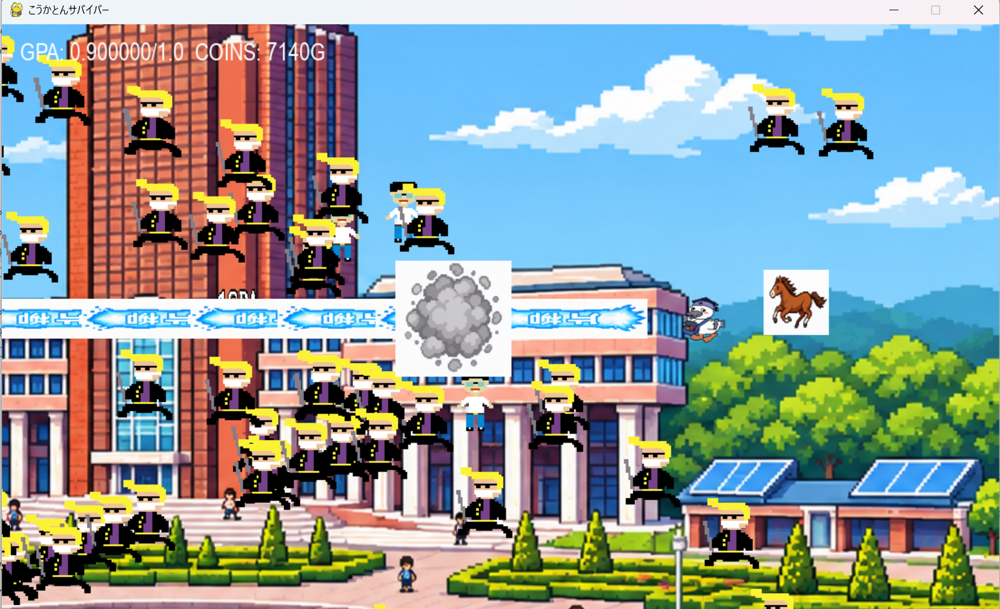

# こうかとんサバイバー

## 実行環境の必要条件
* python >= 3.10
* pygame >= 2.1
* 必要なものがあれば追記してください（非推奨）

## ゲームの概要
* こうかとんが生き残るためにがんばるゲーム
* 色んな敵が出てくるのでやられないようにしてください
* 参考URL：[Vampire Survivors](https://store.steampowered.com/app/1794680/Vampire_Survivors/?l=japanese/)

## ゲームの遊び方
* こうかとんがw/a/s/dで動いて敵を倒して一定時間生き延びるゲーム
* こうかとんの体力が無くなったらゲームオーバー
* ファイルを実行して画面に表示されるSTARTを押すとゲームスタート
* SPACEキーで卵を放つ
* Oキーでビームをうつ
* Iキーでノートpc爆弾を放つ
* Uキーtutの馬が走り回る
* 敵を倒すとコインを20獲得
* Bキーでショップへ移動し、数字キーに対応したアイテムを買って強くなれる
* ショップに入ったら1を押すことでコインを消費して速さが早くなる、2を押すとhpの最大値が増える
* 時間経過でアイテム金のトイレ(コイン10獲得)、1GPA(hpが回復する)がマップに出てくるので移動して取るとそれぞれ使用できる
* ゲームオーバーになると画面が変わり、RESTARTを押すともう一度スタート、EXITを押すとゲームを終了

## ゲームの実装
### 共通基本機能
* 背景画像の描画(学校風)
* こうかとんの移動(w/a/s/d)
* こうかとんの初期攻撃(たまごはスペースキー)
* 初期敵生徒

### 分担追加機能
* 武器実装（担当：福永）： こうかとんが攻撃するアイテム→片柳ビーム、ノートパソコン爆弾、馬が周囲を走る
* 敵実装（担当：青柳）：ヤンキー、謎の科学構造式、かまとぅ、ぱっちぃ(ボス)
* こうかとん強化機能(担当：林):ショップ機能,ショップでステータスをレベルアップ
* アイテム機能(担当 : 青木)：GPAを取得するとHPを1回復、金のトイレを取得するとコインを10獲得する
* マップと、ゲームオーバー演出(担当：大川)：スタート、ゲームオーバー画面、マップ動けるように

### C0C25061 福永和馬
#### やったこと
* 武器を新しく3つ作って攻撃できるようにしました。
#### 1.片柳ビーム
* キーボードのOを押すことで、片柳と書かれたビームを打つことができます。
* 初期装備の卵との違いとしてビームは敵とぶつかっても消えずに貫通します。
#### 2.ノートpc爆弾
* キーボードのiを押すことで、ノートpcの爆弾を打つことができます。
* ノートpcの爆弾そのものには敵との当たり判定が無く、ノートpcが一定距離進むとその場に爆発した画像が普通の画像、反転の画像が交互に一定時間表示されます。この爆発の画像に敵がぶつかると敵が倒せます。
#### 3.東京工科大学の馬
* キーボードのuを押すことでこうかとんを中心として円を描きながら走る馬を使えます。
* 永遠に馬は円を描きながら走って敵とぶつかると倒します。 1体までの制限があります。  
**参考にしたサイト 馬の円運動**   
https://mulberrytassel.com/pygame-start-40/

### C0A25207 林亜龍
#### やったこと
* ショップ
* キーボードのBを押すことで、ショップへ移動することができる。
* ショップでは足の速さとHPの最大値を変更することができる。
* ショップでは対応した数字キーを押すと購入する。
#### 【ショップの商品】
* 速度アップ
* HP最大値アップ  
 **ショップ画面導入の参考資料**  
https://www.reddit.com/r/pygame/comments/rg938v/how_do_i_implement_the_functionality_of_a_start/?tl=ja

### C0A25003 青木大翔 やったこと
#### 【アイテム機能の説明】
* マップ上のランダムな位置に「金のトイレ」と「1GPA」というアイテムが出現する機能を実装した。プレイヤーがアイテムに触れると自動的に取得され、効果音が鳴る。
* 各アイテムはランダムな間隔で出現し、取得後も一定時間が経過すると再出現する。

#### 【アイテムの効果】
* 金のトイレ：コインを10獲得する。
* 1GPA：GPAを1.0回復する。

### C0C25013 大川直透　やったこと
* スタート画面の作成
* STARTでゲーム開始EXITでゲーム終了
* ゲームオーバー画面の作成
* RESTARTで再度挑戦EXITでゲーム終了
* 背景画像の拡大表示
* 背景がこうかとんを追従するように

### C0C25001 青柳公大　やったこと
* 敵を管理する抽象クラスを作成して5種類実装しました
* こうかとんと敵5種類のドット絵を作成しましました
* 出現する敵を1分ごとに変更するようにしました
#### 敵の一覧
* 一般学生
* ヤンキー
* かまとぅ
* ぱっちぃ
* PFAS（強制ゲームオーバーにするために無敵）

## ToDo
* 武器をショップで解放すること
* 敵の強さをそれぞれでわけること
* 一定時間経過するとこうかとんが動けなくなる